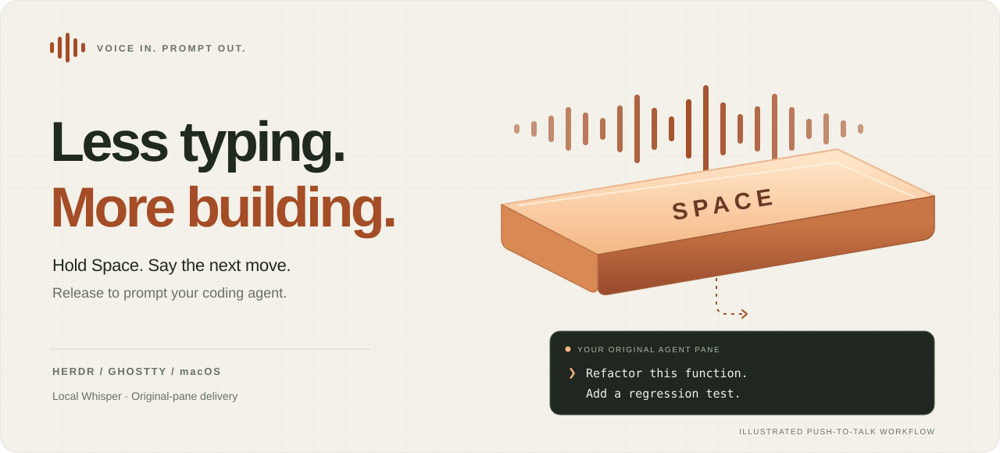

<h1 align="center">vibe-herdr</h1>

<p align="center">
  <strong>생각은 말로. 코딩 흐름은 그대로.</strong><br>
  Space를 누르고 말하세요. 놓으면 Herdr의 코딩 에이전트에 전송합니다.
</p>

<p align="center">
  <a href="https://github.com/chung-song/vibe-herdr/actions/workflows/ci.yml"></a>
  <a href="LICENSE"></a>
  
</p>

<p align="center">
  <a href="#빠른-시작">빠른 시작</a> ·
  <a href="docs/setup.md">설치 안내</a> ·
  <a href="docs/configuration.md">설정</a> ·
  <a href="docs/privacy.md">데이터 흐름</a> ·
  <a href="README.md">English</a>
</p>

<picture>
  <source media="(prefers-color-scheme: dark)" srcset="docs/assets/hero-dark.svg">
  <source media="(prefers-color-scheme: light)" srcset="docs/assets/hero-light.svg">
  
</picture>

<p align="center"><sub>사용 흐름 일러스트 · macOS Apple Silicon, Ghostty, Herdr용</sub></p>

## 코딩 흐름을 이어가세요

| 사용자가 하는 일 | vibe-herdr가 하는 일 |
| --- | --- |
| **Space를 누르고 말하기** | 누르는 동안 녹음하고, 놓으면 음성을 인식해 프롬프트를 전송합니다. |
| **다른 에이전트 패널로 이동하기** | 녹음을 시작할 때 선택한 패널로 전송 대상을 유지합니다. |
| **받아쓰기 끄기** | 진행 중인 작업이 끝나면 음성 인식 모델도 메모리에서 해제합니다. |
| **자동 받아쓰기 선택하기** | 음성을 감지하고, 외부 문장 완료 판단 API로 전송 시점을 판단합니다. |

Whisper 음성 인식은 Mac에서 실행합니다. **Space 모드에는 Jev API 키가 필요 없습니다.** 전송한 프롬프트는 코딩 에이전트의 설정에 따라 외부 제공업체로 전달될 수 있습니다. 자동 모드는 인식된 문장을 TypeSafe Jev로도 보냅니다. [데이터 흐름 자세히 보기 →](docs/privacy.md)

## 빠른 시작

**macOS Apple Silicon, Ghostty, Herdr, Rust/Cargo, CMake, Python 3, Xcode 명령줄 도구**가 필요합니다. 로컬에서는 Herdr 0.9.3으로 사용했습니다.

```sh
git clone https://github.com/chung-song/vibe-herdr.git
cd vibe-herdr
cargo build --release --no-default-features --features whisper

mkdir -p ~/.config/herdr/plugins/config/ranolp.handsfree
cp examples/config.toml ~/.config/herdr/plugins/config/ranolp.handsfree/config.toml
herdr plugin link "$(pwd)"
```

Herdr 설정에 [단축키 두 개](examples/herdr-keybinding.toml)를 추가한 뒤 `herdr server reload-config`를 실행하세요. 원본 handsfree 플러그인이 이미 연결돼 있으면 먼저 연결을 해제하세요. 두 플러그인은 `ranolp.handsfree`라는 같은 ID를 사용합니다.

### 첫 음성 프롬프트 보내기

1. **권한을 허용하세요.** 마이크 권한과 빌드한 `target/release/herdr-handsfree` 실행 파일의 손쉬운 사용 권한이 필요합니다.
2. **Space 모드를 선택하세요.** 받아쓰기가 꺼진 상태에서 `prefix+shift+v`로 `space`를 선택하세요. 최초 기본 모드는 `auto`입니다.
3. **켜고 말하세요.** `prefix+d`로 받아쓰기를 켜세요. 모델과 녹음이 준비되면 Ghostty의 에이전트 패널에서 Space를 누르고 말한 뒤 놓으세요.
4. **사용을 마치면 끄세요.** 진행 중인 Space 모드 작업이 끝난 뒤 `prefix+d`로 끄면 모델도 해제합니다. 모드를 바꾸기 전에도 받아쓰기를 꺼야 합니다.

250ms보다 짧게 누르면 처음 선택한 패널이 계속 활성화돼 있는 경우 일반 공백으로 처리합니다. Space 모드가 켜져 있으면 Ghostty의 다른 창에서도 수정 키 없는 Space 입력을 감지합니다. 권한과 블루투스 마이크 준비 시간은 [상세 설치 안내](docs/setup.md)를 확인하세요.

## 내 환경에 맞추기

- **마이크와 모델:** [예제 설정](examples/config.toml)을 복사해 조절하세요.
- **고유명사:** [단어 목록](examples/glossary.txt)에 인식 힌트를 추가하세요.
- **반복되는 오인식:** [명시적 교정](docs/configuration.md#explicit-corrections)을 저장하세요. 모델을 재학습하는 기능은 아닙니다.
- **자동 받아쓰기:** [한국어 대화에 맞춘 자동 모드](docs/configuration.md#automatic-mode)를 설정하세요. 판단 API가 실패해도 무음 제한 시간이 지나면 미전송 문장이 전송될 수 있습니다.
- **상태 표시:** [선택 기능인 상태 표시와 패널 강조](docs/configuration.md#optional-status-display)를 사용하세요.

상세 문서는 영어로 제공합니다. 다른 마이크나 Herdr 버전에서 사용한 결과는 [이슈](https://github.com/chung-song/vibe-herdr/issues/new)로 알려주세요. 개인 대화와 키는 제거한 뒤 공유하세요. 코드 기여는 [Contributing](CONTRIBUTING.md)을 참고하세요.

유용했다면 스타로 다른 Herdr 사용자에게도 알려주세요.

---

[RanolP/herdr-handsfree](https://github.com/RanolP/herdr-handsfree)의 커뮤니티 포크입니다. Herdr의 공식 릴리스가 아닙니다. [MIT 라이선스](LICENSE) · [원본과 출처](PROVENANCE.md)
