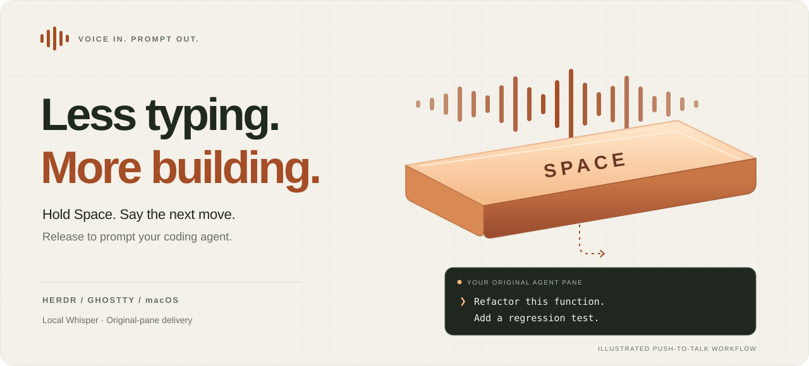

<h1 align="center">vibe-herdr</h1>

<p align="center">
  <strong>Your voice. Your coding flow.</strong><br>
  Hold Space to speak. Release to prompt your coding agent in Herdr.
</p>

<p align="center">
  <a href="https://github.com/chung-song/vibe-herdr/actions/workflows/ci.yml"></a>
  <a href="LICENSE"></a>
  
  
</p>

<p align="center">
  <a href="#quick-start">Quick start</a> ·
  <a href="docs/setup.md">Setup guide</a> ·
  <a href="docs/configuration.md">Configuration</a> ·
  <a href="docs/privacy.md">Data &amp; privacy</a> ·
  <a href="README.ko.md">한국어</a>
</p>

<picture>
  <source media="(prefers-color-scheme: dark)" srcset="docs/assets/hero-dark.svg">
  <source media="(prefers-color-scheme: light)" srcset="docs/assets/hero-light.svg">
  
</picture>

<p align="center"><sub>Workflow illustration · Built for macOS Apple Silicon, Ghostty, and Herdr</sub></p>

## Stay in the flow

| You do | vibe-herdr does |
| --- | --- |
| **Hold Space and speak.** | Records while held; releasing transcribes and submits your prompt. |
| **Move between agent panes.** | Keeps the recording bound to the pane captured at key-down. |
| **Turn dictation off.** | Releases the speech model after in-flight work finishes. |
| **Choose hands-free dictation.** | Uses voice detection and an optional remote turn-completion classifier. |

Whisper transcription runs on your Mac. **Space mode needs no Jev API key.** Submitted prompts still use your coding agent's configured provider; automatic mode also sends text to TypeSafe Jev. [See the data flow →](docs/privacy.md)

## Quick start

Requires **macOS Apple Silicon, Ghostty, Herdr, Rust/Cargo, CMake, Python 3, and Xcode command-line tools**. Tested locally with Herdr 0.9.3.

```sh
git clone https://github.com/chung-song/vibe-herdr.git
cd vibe-herdr
cargo build --release --no-default-features --features whisper

mkdir -p ~/.config/herdr/plugins/config/ranolp.handsfree
cp examples/config.toml ~/.config/herdr/plugins/config/ranolp.handsfree/config.toml
herdr plugin link "$(pwd)"
```

Add [these two keybindings](examples/herdr-keybinding.toml) to your Herdr config, then run `herdr server reload-config`. If the upstream handsfree plugin is already linked, unlink it before linking this fork; both use the ID `ranolp.handsfree`.

### Your first voice prompt

1. **Allow access.** Grant Microphone access, plus Accessibility access for the built `target/release/herdr-handsfree` executable.
2. **Select Space mode.** With dictation off, use `prefix+shift+v` to select `space`. The initial mode is `auto`.
3. **Start talking.** Toggle on with `prefix+d`. Wait for the model and recording readiness, hold Space in your Ghostty agent pane, speak, and release.
4. **Done for now?** Toggle off with `prefix+d` to release the model. Let pending space-mode work finish before turning it off. Turn dictation off before switching modes.

A Space press under 250 ms is treated as a regular space if the original pane remains focused. While enabled, this mode intercepts unmodified Space across Ghostty windows. See the [full setup guide](docs/setup.md) for permissions, microphone startup, and troubleshooting.

## Make it yours

- **Microphone and model:** start with [the example config](examples/config.toml).
- **Names and vocabulary:** add recognition hints to [a glossary](examples/glossary.txt).
- **Repeated misrecognitions:** save [explicit text corrections](docs/configuration.md#explicit-corrections).
- **Hands-free mode:** configure [automatic dictation](docs/configuration.md#automatic-mode), tuned for Korean conversational turns. Unsent drafts can be submitted after a silence timeout even when its classifier fails.
- **Status and accents:** enable [optional recording feedback](docs/configuration.md#optional-status-display).

## Help shape it

Tried another microphone, Herdr version, or language? [Tell us what worked](https://github.com/chung-song/vibe-herdr/issues/new). For changes, see [Contributing](CONTRIBUTING.md). Remove private transcripts and keys from reports.

If this fits your workflow, a star helps other Herdr users find it.

---

A community fork of [RanolP/herdr-handsfree](https://github.com/RanolP/herdr-handsfree). Not an official Herdr release. [MIT license](LICENSE) · [Source &amp; attribution](PROVENANCE.md)
